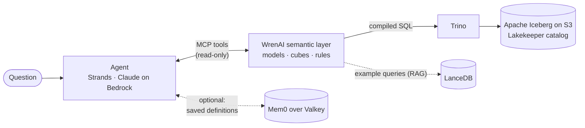
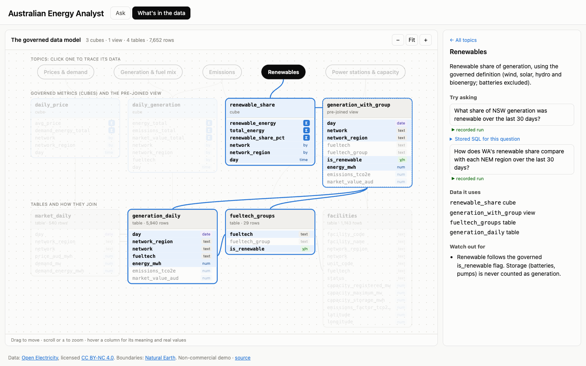
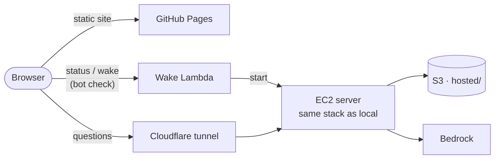

# Agent Analytical Platform

**Ask questions about data in plain English and get answers you can trust.**

An AI agent answers each question, but it can't see raw tables and never types the numbers itself. It works through a **[WrenAI](https://github.com/Canner/WrenAI) semantic layer**: an agreed set of tables, metrics and business rules (for example, "batteries don't count as renewable"). WrenAI turns the agent's request into SQL, and the SQL runs on an Iceberg lakehouse in AWS. Every number in an answer comes from a real query, and you can see exactly which one.

**▶ Try the live demo: [isaacfrith.github.io/agent-analytical-platform](https://isaacfrith.github.io/agent-analytical-platform/)**. Nothing to install.


The data is 90 days of real Australian electricity data from [Open Electricity](https://openelectricity.org.au): generation, prices, emissions and power stations for the east-coast market (the NEM) and Western Australia (the WEM). A second, generated ecommerce dataset tests the infrastructure and the agent's memory.

## Contents

- [Why a semantic layer: WrenAI](#why-a-semantic-layer-wrenai)
- [How it works](#how-it-works)
- [Using the demo](#using-the-demo): no setup needed
- [Run it yourself](#run-it-yourself): the agent, the semantic layer and the lakehouse on your machine
- [Deploy your own live demo](#deploy-your-own-live-demo): the website plus an on-demand AWS server
- [Asking questions from the terminal](#asking-questions-from-the-terminal) · [Updating the demo](#updating-the-demo) · [The data](#the-data) · [Quality checks](#quality-checks) · [Project layout](#project-layout) · [Limitations](#scope-and-limitations)

## Why a semantic layer: WrenAI

Point an AI at raw tables and it will happily invent its own definition of "renewable", sum a price, or mix two markets together. The answer looks right and isn't. This project puts **WrenAI** between the agent and the data, so the definitions are written down once and every answer has to go through them.

**1. The definitions live in [`wren/`](wren), as WrenAI's MDL** (modeling definition language): plain YAML and Markdown, reviewed like code.

| What | Where | Example |
| --- | --- | --- |
| **Models**: the tables the agent may use, with a description of every column | [`wren/models/`](wren/models) | `market_daily`: one row per region and day; price is a rate, so average it, never sum it |
| **Relationships**: how tables join | [`wren/relationships.yml`](wren/relationships.yml) | `generation_daily` → `fueltech_groups` on `fueltech` |
| **Views**: governed pre-joins | [`wren/views/`](wren/views) | `generation_with_group`: generation with its fuel group and renewable flag |
| **Cubes**: governed metrics | [`wren/cubes/`](wren/cubes) | `renewable_share`, `daily_price`, `daily_generation` |
| **Rules**: business definitions the agent must follow | [`wren/knowledge/rules/`](wren/knowledge/rules) | "Coal" means black *and* brown coal; "the NEM" never includes WA |
| **Example queries**: question → SQL pairs it retrieves from | [`wren/knowledge/sql/`](wren/knowledge/sql) | Indexed with `make memory` (LanceDB) |

A metric is defined once, in the cube. Here's the renewable share, abridged from [`wren/cubes/renewable_share/metadata.yml`](wren/cubes/renewable_share/metadata.yml):

```yaml
name: renewable_share
base_object: generation_with_group
measures:
  - name: renewable_share_pct
    expression: 100.0 * SUM(CASE WHEN is_renewable THEN energy_mwh ELSE 0 END) / NULLIF(SUM(energy_mwh), 0)
dimensions: [network, network_region]
time_dimensions: [day]
```

**2. The agent asks for a metric, not SQL.** For *"What share of NSW generation was renewable over the last 30 days?"* the agent's whole request is:

```json
{"cube": "renewable_share", "measures": ["renewable_share_pct"],
 "dimensions": ["network_region"], "filters": ["network_region:eq:NSW1", "day:gte:-30d"]}
```

**3. WrenAI compiles it to SQL**, with the governed definition filled in, and Trino runs it:

```sql
SELECT network_region, 100.0 * SUM(CASE WHEN is_renewable THEN energy_mwh ELSE 0 END)
       / NULLIF(SUM(energy_mwh), 0) AS renewable_share_pct
FROM generation_with_group
WHERE network_region = 'NSW1' AND day >= CAST('2026-09-19' AS TIMESTAMP)
GROUP BY 1
```

The agent never decided what "renewable" means, which fuels count, or how to turn daily rows into one share. Change the definition in the cube and every future answer changes with it.

**4. The agent reaches WrenAI through its MCP tools**, all read-only: `get_instructions` (the rules), `describe_cube`, `query_cube`, `dry_run` (checks SQL against the model before running it) and `run_sql`. It follows one of three paths, and the demo labels every answer with the path it took:

| Label | Path |
| --- | --- |
| ✓ **Governed cube** | A cube answered the question. The most trustworthy path. |
| ▲ **SQL fallback** | No cube fitted, so the agent wrote SQL, but only against the MDL models and views, checked with `dry_run` first. |
| ✕ **Refused** | The data can't answer the question (no hourly data, no Northern Territory), and the agent says so instead of guessing. |

**Teach it a new rule** in one step: this adds the rule to the semantic layer, rebuilds the MDL and reindexes it.

```bash
make refresh rule="Refunds by status always use return_status from returned_orders." title="Refunds by Status"
```

## How it works



| Part | Technology | Role |
| --- | --- | --- |
| Agent | [Strands Agents](https://strandsagents.com), Claude Haiku 4.5 on Amazon Bedrock | A fresh agent per question, with a budget of 10 turns and 150k tokens |
| Semantic layer | [WrenAI](https://github.com/Canner/WrenAI) (MDL, MCP server) | Governed tables, joins, metrics and rules; compiles SQL |
| Query engine | Trino over Apache Iceberg (Lakekeeper REST catalog, S3 storage) | Runs the SQL |
| Memory | Mem0 over Valkey | Optional: a user's own definitions, kept between sessions |
| Infrastructure | Docker Compose (local); Terraform (AWS) | S3 and IAM; the on-demand live server, wake function and budget |

The agent's instructions are plain text in [`prompts/`](prompts): use cubes first, check SQL before running it, refuse rather than guess, and say which definition it used when a word is ambiguous.

## Using the demo

Open the [live demo](https://isaacfrith.github.io/agent-analytical-platform/). It has two tabs.

### The "Ask" tab

1. **Click a suggested question** in the middle panel. Three suggestions rotate there, drawn from 24 recorded questions (those tagged *Beyond the data* show the agent refusing). Each replays a real recorded run of the agent: free, instant and identical every time. After an answer, **Ask next** offers related questions.
2. **Read the three panels from left to right:**

   | Panel | What it shows |
   | --- | --- |
   | **How it got there** (left) | Each step the agent took, with how long it took and its path label. Expand a step to see the request the agent sent and the SQL WrenAI compiled. The meters show how much of the budget (10 turns, 150k tokens) it used. |
   | **Answer** (middle) | The answer and a chart drawn only from rows a query actually returned. |
   | **Map** (right) | Power stations by fuel and capacity, states shaded by renewable share. Answers by region recolour the states; answers about power stations highlight them. |

3. Tick **Show reasoning** to see the agent's own notes between steps.

### The "What's in the data" tab

Use this tab to find out what you can ask. It's built from the WrenAI model itself, so it can't drift from what the agent sees.



- **The diagram** shows three rows: **topics**, the **cubes** built for them, and the **tables** with every column and how they join. **Click a topic** to light up the cubes, tables and columns its questions use.
- **Hover a column** for its meaning and its real values.
- **The panel** lists the topics, example questions, and what the data **can't** answer. **How we define things** opens the business rules.

### Asking your own questions

The box under the answer runs the real agent on your question. The server behind it **sleeps when nobody's asking**: click **Start live questions** and wait about two minutes while it starts the whole lakehouse. Each visitor gets **2 live questions a day**, after an invisible bot check. The suggested questions always work.

## Run it yourself

| I want to… | What I need | Commands |
| --- | --- | --- |
| **Run the demo site on my machine** | This repo and Python 3 | `make demo-serve`, then open http://localhost:8765 |
| **Ask the agent my own questions** | The setup below | `make ask q="…"` |
| **Host my own live demo** | The setup below, admin AWS credentials | [Deploy your own live demo](#deploy-your-own-live-demo) |

The recordings and the data catalog are committed in `ui/data/`, so the demo site alone needs no AWS, no Docker and no keys.

**You need:**

- [uv](https://docs.astral.sh/uv/) (it installs Python 3.12 and the dependencies) and Docker.
- An AWS account with **admin credentials** for Terraform, and access to an Anthropic model on Amazon Bedrock. The defaults use Claude Haiku 4.5 in Sydney (`ap-southeast-2`).
- A free API key from [Open Electricity](https://openelectricity.org.au).

**Steps:**

```bash
cp terraform/terraform.tfvars.example terraform/terraform.tfvars   # region, bucket name, budget email
make infra-init infra-apply       # creates the S3 bucket, an app IAM user and the roles (admin credentials)
                                  # then create an access key for the app user (`terraform output iam_user_name`)
                                  # and add it to ~/.aws/credentials as its own profile
cp .env.example .env              # fill in: that profile, region, bucket, Bedrock model ID, Open Electricity key,
                                  # and LAKEKEEPER_STS_ROLE_ARN (`terraform output lakekeeper_vending_role_arn`)
make preflight                    # checks the app user's identity, the bucket and Bedrock access
make up                           # starts Postgres, Lakekeeper, Trino and Valkey in Docker
make bootstrap                    # one-time: creates the Iceberg warehouse on S3
make energy-data                  # loads 90 days of energy data (and `make data pipeline` for ecommerce)
make profile                      # one-time: tells WrenAI how to reach the local Trino
make mdl memory                   # builds the semantic layer and indexes it
make mdl-test energy-test         # checks it all works (no AI involved)
make ask q="Which region had the highest average price last week?"
```

`make help` lists every command. `make down` stops the local services (your data is kept); `make infra-destroy` deletes the AWS resources, including the bucket.

**What it costs:** a question uses about 15,000–50,000 tokens, a few cents on Haiku 4.5. The checks use no AI and cost nothing.

## Deploy your own live demo

The website is static (GitHub Pages) and can't run the agent, so live questions run on **one AWS server that starts on demand**: the same Docker stack as your laptop, plus WrenAI and the agent.



- A visitor clicks **Start live questions**. After a bot check, a Lambda function starts the server. On every start, the server pulls the latest `main`, starts the stack, and opens an outbound Cloudflare tunnel.
- The server **stops itself** after 20 minutes without a question, and runs at most 3 hours a day. Its data lives under `hosted/` in the bucket and refreshes itself when it's over 3 days old.
- **Limits**, enforced on the server: 2 questions per visitor per day, 20 a day in total, one at a time, 6 wakes a day, 3 hours of running a day. You get 30 a day of your own with the [owner pass](#your-own-allowance-the-owner-pass).
- **Cost backstop:** an AWS budget ($20 a month by default) emails you at 50% and 80%, and at 100% stops the server and blocks the wake function. **Typical cost:** a few dollars a month (the server only runs when used, plus about $3 a month of disk).
- **Security:** no inbound ports and no SSH (Session Manager for emergencies); no stored AWS keys (an IAM role limited to the `hosted/` prefix, the one Bedrock model and its own settings); secrets in SSM Parameter Store, never in the repo or Terraform state; the agent is read-only.

### Deploy it (once)

Do the [setup](#run-it-yourself) first. Then:

1. **Publish the site.** Fork the repo, then in your fork: Settings → Pages → Source: **GitHub Actions**. The site is at `https://<you>.github.io/agent-analytical-platform/`.
2. **Create a Cloudflare Turnstile widget** (free bot check) at [dash.cloudflare.com](https://dash.cloudflare.com) → Turnstile, for the hostname `<you>.github.io` (any widget mode works). Keep the site key and the secret.
3. **Point Terraform at your fork.** In `terraform/terraform.tfvars`, set `site_origin`, `repo_url`, `turnstile_site_key` and `budget_email` (see [`terraform.tfvars.example`](terraform/terraform.tfvars.example)). Also put your origin in `DEMO_ALLOWED_ORIGINS` if you'll test live questions locally.
4. **Create the resources** with admin credentials: `make infra-plan`, check the plan, then `make infra-apply`.
5. **Set the secrets.** Terraform prints these commands as the `live_set_secrets` output; add `--profile <admin profile>` if your shell defaults to the app user:
   ```bash
   aws ssm put-parameter --region ap-southeast-2 --overwrite --type SecureString --name /agent-analytics/live/turnstile-secret --value 'YOUR_TURNSTILE_SECRET'
   aws ssm put-parameter --region ap-southeast-2 --overwrite --type SecureString --name /agent-analytics/live/openelectricity-key --value 'YOUR_OPENELECTRICITY_KEY'
   ```
6. **Point the site at the server:** `make live-config`, then commit `ui/live-config.json` and push.

Open your site and click **Start live questions**. The first start installs everything and loads the data (about 15 minutes); after that, starts take about 2 minutes.

### Your own allowance: the owner pass

The owner pass gives you **30 live questions a day of your own** on the public site, without using up visitors' 20. Everything else still applies to you: the bot check, one at a time, the wake and running limits, and the budget.

1. **Create the pass** (Terraform prints these as `live_owner_pass`). The first command stores a random pass; the second prints your private link:
   ```bash
   aws ssm put-parameter --region ap-southeast-2 --overwrite --type SecureString --name /agent-analytics/live/owner-pass --value "$(openssl rand -hex 24)"
   echo "https://<you>.github.io/agent-analytical-platform/?owner=$(aws ssm get-parameter --region ap-southeast-2 --with-decryption --name /agent-analytics/live/owner-pass --query Parameter.Value --output text)"
   ```
2. **Open the link once** in each browser you'll use. The page keeps the pass in that browser and removes it from the address bar; the box shows **Owner · N of 30 left today**. **Forget owner pass** removes it.

The server reads the pass when it starts, so a new or changed pass works from its next start. Keep the link private.

### Run it

| I want to… | Do this |
| --- | --- |
| Turn live questions off now | `aws ssm put-parameter --region ap-southeast-2 --overwrite --type String --name /agent-analytics/live/switch --value off` (`on` to undo) |
| See what the server is doing | AWS console → Systems Manager → Session Manager → connect, then `journalctl -u live -f` |
| Recover after the budget action fired | Check the spend, then AWS console → Budgets → `agent-analytics-monthly` → Actions → reverse both |
| Test live questions on my laptop | `make up`, then `make demo-live` (prints a link) and `make demo-serve` in a second terminal. No bot check locally; the limits still apply. |
| Remove it all | `make infra-destroy` (also deletes the bucket) |

## Asking questions from the terminal

```bash
make ask q="What share of NSW generation was renewable over the last 30 days?"
```

The terminal shows each tool call, the answer, and the turns and tokens used:

```
Tool #1: get_instructions          ← reads the business rules
Tool #2: describe_cube             ← looks up the renewable_share cube
Tool #3: query_cube                ← asks WrenAI for the number
**Answer: 46.3% of NSW generation was renewable over the last 30 days.**
[budget] turns=3/10 tokens=19088/150000 (within budget)
```

Questions that show the agent's behaviour well:

| Question | What to look for |
| --- | --- |
| What share of NSW generation was renewable over the last 30 days? | One `query_cube` call: a cube does all the work |
| On the highest-price day in the last 30 days, which fuel types generated the most? | A two-step question answered with one SQL query |
| Show me operating coal capacity by state. | "Coal" includes Victoria's brown coal, because the rules say so |
| Show me generation by unit efficiency. | A refusal: there's no efficiency data |
| Show me orders by status. | "status" exists in two tables, so it says which one it used |

**Options:**

```bash
uv run python scripts/ask.py --domain energy "Compare emissions for NSW and WA last week"   # energy rules only
make ask-mem q="Remember: high-value orders means total_amount greater than 1000."          # save a definition
make ask-mem q="Show me high-value orders from last week."                                 # a new agent uses it
make memory-check                                                                          # list saved definitions
```

## Updating the demo

The demo site is plain files in [`ui/`](ui). GitHub Pages republishes it about a minute after every push to `main` that changes `ui/`.

1. **Refresh the data** (optional; it's a rolling 90 days): `make energy-data`
2. **Re-record:** `make demo-record` re-runs all 24 suggested questions through the real agent (about 15 minutes, roughly a dollar on Haiku 4.5). It checks each one still gets the expected kind of answer, and rebuilds the map data and the data catalog.
   - Only some questions: `uv run python scripts/demo_record.py --only price_by_region,wa_vs_nem`
   - Only the data tab (free, no AI): `uv run python scripts/demo_record.py --catalog-only`
3. **Check it locally:** `make demo-serve`, then open http://localhost:8765. (Opening `ui/index.html` from disk won't work: browsers block it from loading its data.)
4. **Publish:** commit `ui/data/` and push.

The suggested questions are in [`demos/energy-questions.yml`](demos/energy-questions.yml) and the data tab's topics in [`demos/energy-topics.yml`](demos/energy-topics.yml). Recording fails if either names something that doesn't exist in the model. For presenting from a terminal there's [`demos/energy.md`](demos/energy.md).

## The data

**Energy.** Every row is tagged with its market (`network`): the NEM and the WEM are separate markets, so "the NEM" never includes WA. The Northern Territory has no public market data. Data from Open Electricity, licensed [CC BY-NC 4.0](https://creativecommons.org/licenses/by-nc/4.0/) (non-commercial use).

| Table | Rows | One row per… |
| --- | --- | --- |
| `facilities` | ~1,140 | Generating unit: fuel, status, registered capacity (MW), location |
| `generation_daily` | ~5,940 | Region, fuel and day: energy (MWh), emissions (tCO2e), market value (AUD) |
| `market_daily` | 540 | Region and day (6 regions): spot price (AUD/MWh), demand |
| `fueltech_groups` | 29 | Fuel type: its group (coal, gas, solar…) and whether it counts as renewable |

Cubes: `daily_generation`, `daily_price` and `renewable_share`.

**Ecommerce.** Load with `make data pipeline`. Generated customers, products, 30,000 orders, order items, payments and returns. Cubes: `daily_revenue`, `product_performance` and `refunds_cube`.

## Quality checks

| Command | What it checks | Uses AI? |
| --- | --- | --- |
| `make test` | Unit tests | No |
| `make lint` | Code style (ruff) | No |
| `make mdl-test` | 24 checks on the semantic layer: tables, joins, cubes, example queries | No |
| `make energy-test` | 15 checks on the energy data: coverage, duplicates, markets, locations | No |
| `make evals` | 16 questions against the real agent, graded automatically (30–45 minutes) | Yes |

The eval cases are in [`evaluations/golden_suite.json`](evaluations/golden_suite.json): cube routing, harder data-model questions, refusals and the memory lifecycle. Run one with `uv run python evaluations/run_evals.py --tests energy_cube_time_window`.

## Project layout

```
wren/             the WrenAI semantic layer: models, views, cubes, joins, rules, example queries
prompts/          the agent's instructions: shared rules plus one file per dataset
src/
  agent/          the agent: orchestrator, cube tool, trace events for the UI, memory tools
  api/            live questions (bot check, limits, owner pass, streaming)
  demo/           builds the data catalog from the semantic layer
  memory/         saved user definitions (Mem0 over Valkey)
scripts/          entry points: ask, load data, checks, record and serve the demo
  hosted/         the live server's boot sequence and watchdog
ui/               the demo website (data/ holds the recordings and the catalog)
demos/            the suggested questions, topics and a terminal presenter script
evaluations/      eval questions and the harness that grades them
tests/            unit tests
docker/           the local services
terraform/        AWS: bucket and IAM; the live server, wake Lambda and budget
docs/             screenshots and the UI's design notes
```

## Scope and limitations

This is a proof of concept, not a production system: data reloads replace everything, saved definitions belong to one user, and locally the secrets live in `.env`. Upstream's [PRODUCTION_CONSIDERATIONS.md](https://github.com/jaehyeon-kim/agentic-analytics-system/blob/main/PRODUCTION_CONSIDERATIONS.md) covers what production would need.

Two workarounds for WrenAI 0.15–0.16 bugs, to remove once fixed upstream:

- **Date filters on cubes.** WrenAI writes cube date filters as plain text, which Trino rejects. The agent's own `query_cube` ([`src/agent/cube_query.py`](src/agent/cube_query.py)) types the dates before the query runs.
- **Row order.** WrenAI's `run_sql` can return the right rows in the wrong order. Charts and answers sort their rows, so the demo isn't affected.

Inspired by [jaehyeon-kim/agentic-analytics-system](https://github.com/jaehyeon-kim/agentic-analytics-system), adapted for AWS (S3, Bedrock and Terraform).
