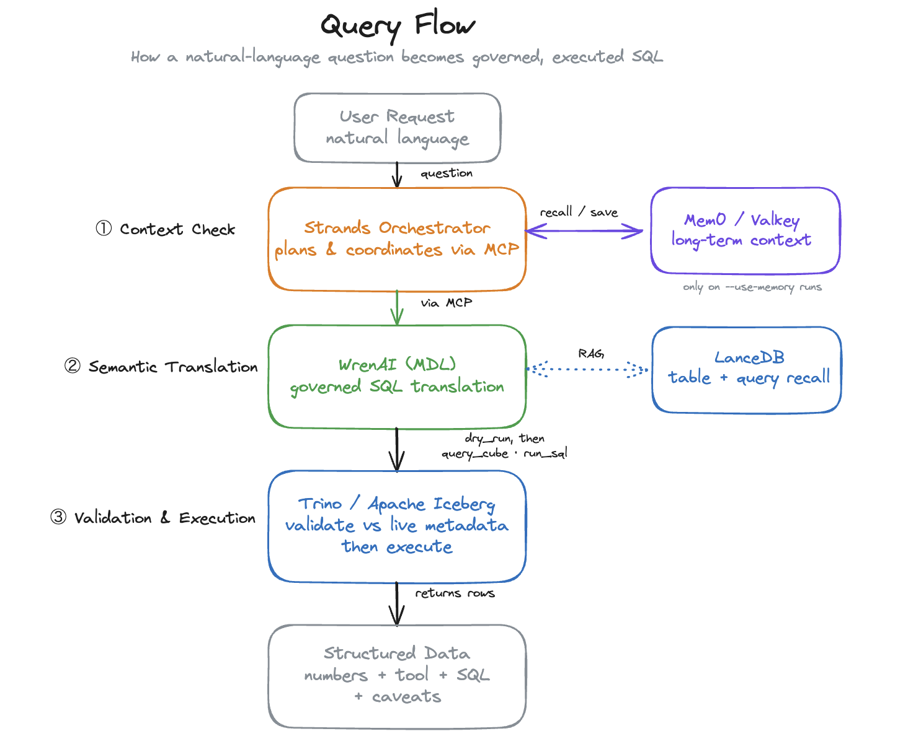

# Agent Analytical Platform

Conversational analytics over an Iceberg lakehouse: a Strands agent answers data questions through a governed WrenAI semantic layer, with Trino execution and Mem0 long-term memory. Inspired by [jaehyeon-kim/agentic-analytics-system](https://github.com/jaehyeon-kim/agentic-analytics-system), adapted for AWS (S3 + Bedrock + Terraform).

The LLM never sees raw tables. It reasons over governed models, cubes, and business rules; WrenAI compiles the SQL deterministically.

## Architecture

| Component | Technology | Role |
| --- | --- | --- |
| Agent | Strands SDK (Bedrock) | Interprets questions, plans tool calls, one fresh agent per question |
| Semantic layer | WrenAI (MDL) | Governed models, relationships, cubes, business rules; exposes MCP tools |
| Execution | Trino + Iceberg (Lakekeeper catalog, S3 storage) | Physical query engine over the lakehouse |
| Memory | Mem0 over Valkey | User preferences persist across sessions |
| Infra | Terraform (AWS) + Docker Compose (local) | Bucket/IAM provisioned; Postgres, Lakekeeper, Trino, Valkey local |


## Prerequisites

- [uv](https://docs.astral.sh/uv/) with Python 3.12+
- Docker with compose support
- AWS credentials under a profile (`~/.aws/credentials`), with Bedrock + S3 access

## Deploy

Two halves: AWS resources via Terraform, compute locally via Docker.

```bash
cp .env.example .env   # fill in profile, region, bucket, Bedrock model ID
make preflight         # verify AWS identity, bucket, Bedrock access
make infra-init infra-apply   # provision S3 bucket + IAM roles (Terraform)
make up                # start Postgres, Lakekeeper, Trino, Valkey
make bootstrap         # create the S3-backed warehouse
make data pipeline     # generate Faker data -> landing Parquet -> Iceberg tables
make mdl memory        # compile MDL, index semantic memory
```

Tear down: `make down` stops the local stack (keeps the Postgres volume, so bootstrap survives restarts); `make infra-destroy` wipes the bucket and all AWS resources.

## Usage

```bash
make ask q="What was daily gross revenue over the last 7 days?"
make ask-mem q="Show me high-value orders from last week."   # memory-enabled
make memory-check      # dump stored preferences
make wren-query q="SELECT COUNT(*) FROM orders"              # query WrenAI directly
```

Teach it a rule (rebuilds + reindexes in one step):

```bash
make refresh rule="When asked for refunds by status, always use return_status from returned_orders." title="Refunds by Status"
```

Check the layer without the agent (fast, deterministic, no LLM):

```bash
make mdl-test
```

Run the eval suite (8 cases: cube routing, ambiguity, refusals, memory lifecycle):

```bash
make evals
```

## Learn it (guided tour)



Every `ask` prints the answer on stdout and the agent's trace on stderr: `Tool #N:` lines show each step, `[budget]` shows turns/tokens. Watch the trace — it's where the learning happens.

1. **Health check, no LLM:** `make mdl-test` — 14 checks prove models, joins, cubes, and seed queries all resolve. If this is red, don't bother asking the agent anything.
2. **Governed metric:** `make ask q="What was daily gross revenue over the last 7 days?"` — trace should show `query_cube` on `daily_revenue`. The agent never wrote `GROUP BY`; WrenAI compiled it.
3. **Fallback path:** `make ask q="How many orders are there in total?"` — no cube covers this, so watch it switch to `dry_run` then `run_sql` (answer: 30,000).
4. **Refusal:** `make ask q="Show me returns by return_reason."` — `return_reason` names no column. A good answer names the unknown identifier and offers the closest real one (`reason`) instead of hallucinating.
5. **Memory:** `make ask-mem q="Remember: high-value orders means total_amount greater than 1000."` then `make ask-mem q="Show me high-value orders from last week."` then `make memory-check` — the definition persists across the two fresh agents via Valkey.
6. **One eval case:** `uv run python evaluations/run_evals.py --tests ambiguous_status` — see how `golden_suite.json` pins behaviour and `run_evals.py` grades it.
7. **Read the prompt:** `src/agent/orchestrator.py:43-69` — the whole agent policy (cube-first, dry-run-before-execute, refusal, disambiguation) fits on one screen. Every trace you watched above is this prompt playing out.

## Layout

- `src/agent/` — orchestrator (system prompt, budgets) and memory tools
- `src/repo_config.py` — shared setup: paths, env validation, Valkey namespace, wren runner
- `scripts/` — `ask.py`, pipeline, bootstrap, `refresh_semantics.py`, `test_semantics.py`
- `scripts/fetch_energy_data.py` + `test_energy_data.py` — energy pipeline and its gate
- `wren/` — MDL project: `models/`, `cubes/`, `relationships.yml`, `knowledge/` (rules, seed SQL)
- `evaluations/` — golden suite + harness (`run_evals.py`)
- `terraform/` — S3 bucket, IAM roles
- `docker/` — local lakehouse stack

## Energy domain (showcase)

Live data for both markets the [Open Electricity API](https://openelectricity.org.au)
covers — the east-coast NEM (five regions) and WA's WEM (south-west WA, one
region; a separate, unconnected market). Every fact row carries `network`
(NEM|WEM). The Northern Territory has no public market data and is not covered.
It needs a free key in `.env` (`OPENELECTRICITY_API_KEY`; data licenced
CC BY-NC 4.0) and sits beside ecommerce in a separate `energy` namespace —
same warehouse, nothing existing moves.

```bash
make energy-data   # fetch 90 daily days → landing Parquet → energy.* tables
make energy-test   # 15 data-invariant checks against Trino (counts, 90-day
                   # coverage per network, key uniqueness, network/region
                   # consistency, fueltech mapping, locations, recency)
```

| Table | Rows | Grain |
| --- | --- | --- |
| `energy.facilities` | ~1,140 | unit (site columns + latitude/longitude carried; statuses include operating, committed, commissioning, retired) |
| `energy.generation_daily` | ~5,940 | region × fueltech × day (energy MWh, emissions tCO2e, market value AUD; battery negatives = charging) |
| `energy.market_daily` | 540 | region × day, 6 regions (price AUD/MWh, demand MW, demand energy MWh) |
| `energy.fueltech_groups` | 29 | static mapping: fueltech → group + governed `is_renewable` flag |

## Visual demo (energy UI)

A three-pane web page — agent steps | answer + chart | NEM map — in `ui/`,
published to GitHub Pages. Demo questions replay recorded runs ($0 per
view); free-text questions go live from this laptop, passcode-gated.

```bash
make demo-record   # re-run the six chips (~$1 Bedrock) + map snapshot → ui/data/
make demo-serve    # view locally at http://localhost:8765
make demo-live     # live mode: API + Cloudflare quick tunnel, prints the share link
```

Commit `ui/data/` after recording; pushing to `main` deploys the site. Live
mode needs `DEMO_PASSCODE` in `.env` and `brew install cloudflared`. Design
and decisions: `demos/energy-ui-plan.md`. Presenter script for the CLI:
`demos/energy.md`.

## Scope

Single-user local proof of concept: destructive data reloads, one fixed memory user, agent holds `run_sql`, secrets in `.env`. See upstream's [PRODUCTION_CONSIDERATIONS.md](https://github.com/jaehyeon-kim/agentic-analytics-system/blob/main/PRODUCTION_CONSIDERATIONS.md) for what production would take.

## Demo (play around)

```bash
# Governed metric — watch the trace use query_cube, no hand-written SQL
make ask q="What was daily gross revenue over the last 7 days?"

# Raw SQL fallback — no cube covers this, so dry_run then run_sql
make ask q="How many orders are there in total?"

# Multi-table reasoning through the product_performance cube
make ask q="Which product category brings in the most revenue?"

# Ambiguity — status lives on two tables; watch it qualify which one
make ask q="Show me orders by status."

# Refusal — return_reason names no column; it should offer reason instead
make ask q="Show me returns by return_reason."

# Memory — teach once, use across fresh agents
make ask-mem q="Remember: high-value orders means total_amount greater than 1000."
make ask-mem q="Show me high-value orders from last week."
make memory-check
```
