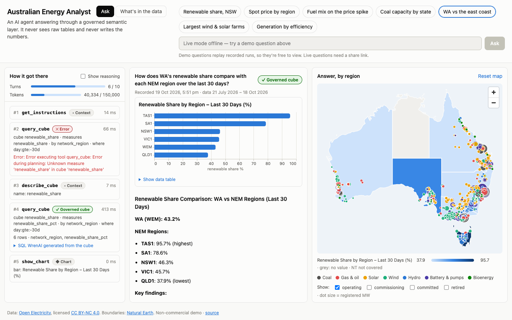
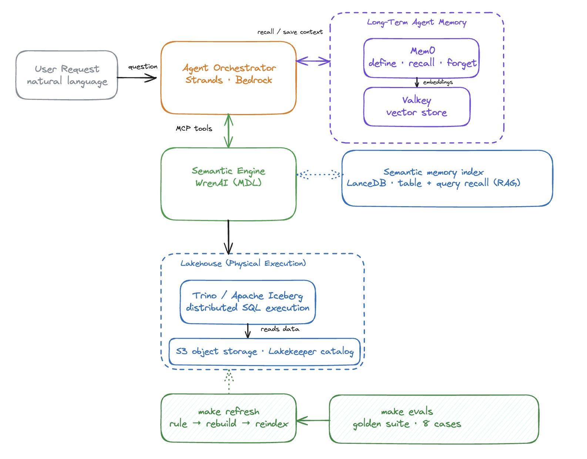

# Agent Analytical Platform

**Ask questions about data in plain English and get answers you can trust.**

An AI agent answers each question, but it never sees raw tables and never writes the numbers itself. It works through a **[WrenAI](https://github.com/Canner/WrenAI) semantic layer**: agreed tables, metrics and business rules. WrenAI turns the agent's request into SQL, which runs on an Iceberg lakehouse in AWS. Every number comes from a real query you can inspect.

**▶ Try the live demo: [isaacfrith.github.io/agent-analytical-platform](https://isaacfrith.github.io/agent-analytical-platform/)**. Nothing to install.



The demo uses 90 days of real Australian electricity data from [Open Electricity](https://openelectricity.org.au): generation, prices, emissions and power stations for the east coast (NEM) and Western Australia (WEM).

## How it works



Point an AI at raw tables and it invents its own definition of "renewable", sums a price, or mixes two markets. Here, the definitions are written once in WrenAI ([`wren/`](wren)), and the agent asks for a **metric**, not SQL. For *"What share of NSW generation was renewable over the last 30 days?"* its whole request is:

```json
{"cube": "renewable_share", "measures": ["renewable_share_pct"],
 "dimensions": ["network_region"], "filters": ["network_region:eq:NSW1", "day:gte:-30d"]}
```

WrenAI fills in the governed definition and compiles the SQL that Trino runs:

```sql
SELECT network_region, 100.0 * SUM(CASE WHEN is_renewable THEN energy_mwh ELSE 0 END)
       / NULLIF(SUM(energy_mwh), 0) AS renewable_share_pct
FROM generation_with_group
WHERE network_region = 'NSW1' AND day >= CAST('2026-09-19' AS TIMESTAMP)
GROUP BY 1
```

Every answer is labelled with how it was reached:

| Label | Meaning |
| --- | --- |
| ✓ **Governed cube** | A pre-defined metric answered it. The most trustworthy path. |
| ▲ **SQL fallback** | No metric fitted, so the agent wrote SQL, checked against the approved tables first. |
| ✕ **Refused** | The data can't answer it, so the agent says so instead of guessing. |

**Built with:** [Strands Agents](https://strandsagents.com) and Claude Haiku 4.5 on Amazon Bedrock · WrenAI (MDL, over MCP) · Trino, Apache Iceberg and Lakekeeper on S3 · Mem0 over Valkey · Docker and Terraform.

## Quick start

**Just the demo site** (no AWS, Docker or keys; the recordings are committed): `make demo-serve`, then open http://localhost:8765.

**The whole platform** needs [uv](https://docs.astral.sh/uv/), Docker, an AWS account with Bedrock access to Claude, and a free [Open Electricity](https://openelectricity.org.au) API key.

```bash
cp terraform/terraform.tfvars.example terraform/terraform.tfvars   # region, bucket name, budget email
make infra-init infra-apply   # S3 bucket, app IAM user and roles (admin credentials);
                              # then add an access key for the app user as an AWS profile
cp .env.example .env          # that profile, region, bucket, model ID, Open Electricity key and
                              # LAKEKEEPER_STS_ROLE_ARN (`terraform output lakekeeper_vending_role_arn`)
make preflight up bootstrap   # check AWS access, start the local stack, create the warehouse
make energy-data              # load 90 days of energy data
make profile mdl memory       # connect WrenAI to Trino, build and index the semantic layer
make ask q="Which region had the highest average price last week?"
```

A question costs a few cents on Haiku 4.5. `make help` lists every command.

## Guides

| Guide | What's in it |
| --- | --- |
| [The semantic layer](docs/semantic-layer.md) | How WrenAI is used: models, joins, cubes, rules, example queries, and teaching it new rules |
| [Using and updating the demo](docs/demo.md) | The two tabs, live questions, and re-recording and publishing the demo |
| [Deploy your own live demo](docs/deploy.md) | The on-demand AWS server: setup, limits, costs, security and running it |
| [Development](docs/development.md) | Asking from the terminal, the data, quality checks and the project layout |

## Scope

A proof of concept, not a production system. See upstream's [PRODUCTION_CONSIDERATIONS.md](https://github.com/jaehyeon-kim/agentic-analytics-system/blob/main/PRODUCTION_CONSIDERATIONS.md) for what production would need. Energy data is licensed [CC BY-NC 4.0](https://creativecommons.org/licenses/by-nc/4.0/) (non-commercial use).

Inspired by [jaehyeon-kim/agentic-analytics-system](https://github.com/jaehyeon-kim/agentic-analytics-system), adapted for AWS (S3, Bedrock and Terraform).
