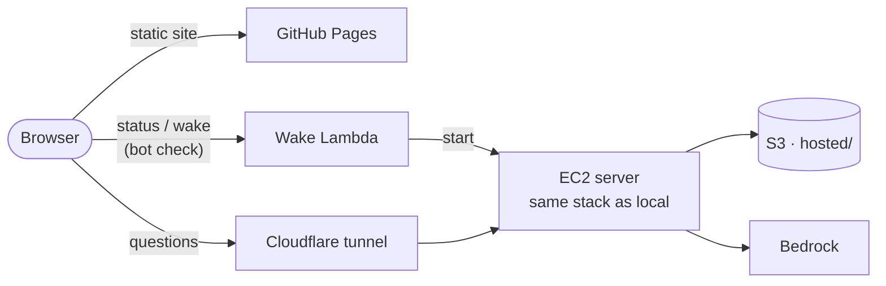

# Deploy your own live demo

The website is static (GitHub Pages) and can't run the agent, so live questions run on **one AWS server that starts on demand**: the same Docker stack as your laptop, plus WrenAI and the agent.



- A visitor clicks **Start live questions**. After a bot check, a Lambda function starts the server. On every start, the server pulls the latest `main`, starts the stack, and opens an outbound Cloudflare tunnel.
- The server **stops itself** after 20 minutes without a question, and runs at most 3 hours a day. Its data lives under `hosted/` in the bucket and refreshes itself when it's over 3 days old.
- **Limits**, enforced on the server: 2 questions per visitor per day, 20 a day in total, one at a time, 6 wakes a day, 3 hours of running a day.
- **Cost backstop:** an AWS budget ($20 a month by default) emails you at 50% and 80%, and at 100% stops the server and blocks the wake function. **Typical cost:** a few dollars a month (the server only runs when used, plus about $3 a month of disk).
- **Security:** no inbound ports and no SSH (Session Manager for emergencies); no stored AWS keys (an IAM role limited to the `hosted/` prefix, the one Bedrock model and its own settings); secrets in SSM Parameter Store, never in the repo or Terraform state; the agent is read-only.

## Deploy it (once)

Do the [quick start](../README.md#quick-start) first. Then:

1. **Publish the site.** Fork the repo, then in your fork: Settings → Pages → Source: **GitHub Actions**. The site is at `https://<you>.github.io/agent-analytical-platform/`.
2. **Create a Cloudflare Turnstile widget** (free bot check) at [dash.cloudflare.com](https://dash.cloudflare.com) → Turnstile, for the hostname `<you>.github.io` (any widget mode works). Keep the site key and the secret.
3. **Point Terraform at your fork.** In `terraform/terraform.tfvars`, set `site_origin`, `repo_url`, `turnstile_site_key` and `budget_email` (see [`terraform.tfvars.example`](../terraform/terraform.tfvars.example)). Also put your origin in `DEMO_ALLOWED_ORIGINS` if you'll test live questions locally.
4. **Create the resources** with admin credentials: `make infra-plan`, check the plan, then `make infra-apply`.
5. **Set the secrets.** Terraform prints these commands as the `live_set_secrets` output; add `--profile <admin profile>` if your shell defaults to the app user:
   ```bash
   aws ssm put-parameter --region ap-southeast-2 --overwrite --type SecureString --name /agent-analytics/live/turnstile-secret --value 'YOUR_TURNSTILE_SECRET'
   aws ssm put-parameter --region ap-southeast-2 --overwrite --type SecureString --name /agent-analytics/live/openelectricity-key --value 'YOUR_OPENELECTRICITY_KEY'
   ```
6. **Point the site at the server:** `make live-config`, then commit `ui/live-config.json` and push.

Open your site and click **Start live questions**. The first start installs everything and loads the data (about 15 minutes); after that, starts take about 2 minutes.

## Run it

| I want to… | Do this |
| --- | --- |
| Turn live questions off now | `aws ssm put-parameter --region ap-southeast-2 --overwrite --type String --name /agent-analytics/live/switch --value off` (`on` to undo) |
| See what the server is doing | AWS console → Systems Manager → Session Manager → connect, then `journalctl -u live -f` |
| Recover after the budget action fired | Check the spend, then AWS console → Budgets → `agent-analytics-monthly` → Actions → reverse both |
| Test live questions on my laptop | `make up`, then `make demo-live` (prints a link) and `make demo-serve` in a second terminal. No bot check locally; the limits still apply. |
| Remove it all | `make infra-destroy` (also deletes the bucket) |
